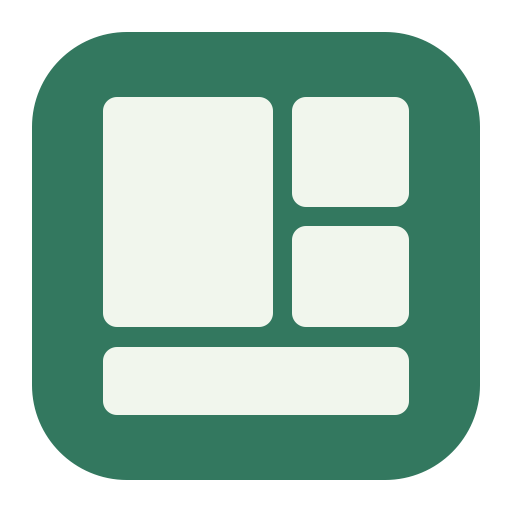
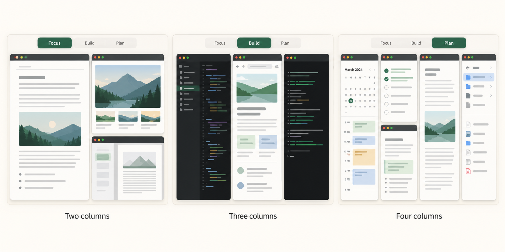
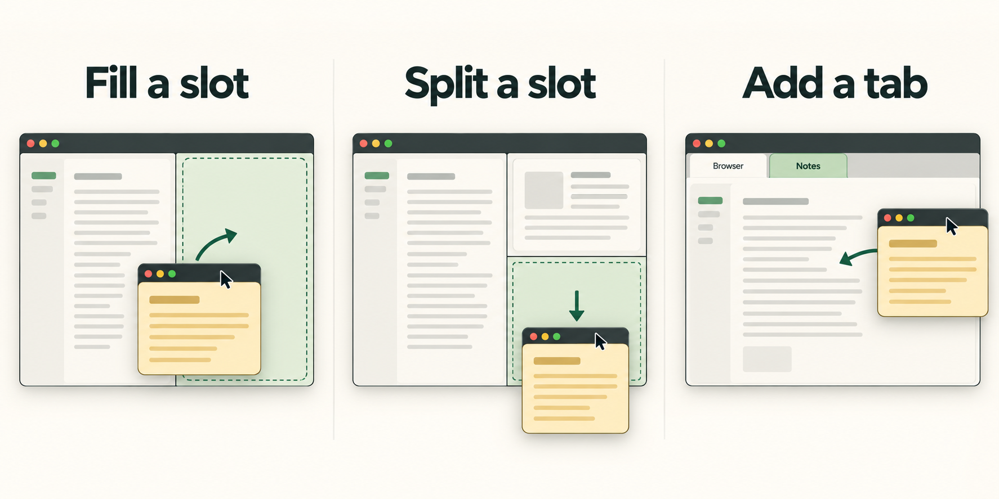

<p align="center">
  
</p>

<h1 align="center">Canopy</h1>

<p align="center"><strong>Your windows. Your workspace.</strong><br>
A free, open source window manager for macOS.</p>

<p align="center">
  <a href="LICENSE"></a>
  
  
  <a href="https://github.com/luketas/canopy/actions/workflows/ci.yml"></a>
</p>

<p align="center">
  <a href="#get-started">Get started</a> ·
  <a href="docs/usage.md">User guide</a> ·
  <a href="CONTRIBUTING.md">Contribute</a> ·
  <a href="CHANGELOG.md">Changelog</a>
</p>



Give each kind of work its own grid. Keep a focused writing setup, a three-column development workspace, and a planning layout a tab away. Choose the apps, split the space, and switch from the tabs at the top of your screen or a global keyboard shortcut.

Canopy is a native SwiftUI and AppKit app. No subscriptions, accounts, or package dependencies.

## A grid for every way you work

- **Independent workspaces.** Each tab keeps its own apps, layout, zoom, and saved views. A window can belong to more than one arrangement.
- **Columns and nested splits.** Start with 1–4 columns. Stack apps inside a column, give a window its own column, or divide a slot again.
- **Tabs across apps.** Group windows in the same slot and switch between them without changing the rest of the grid.
- **Direct editing.** Drag apps into place, remove them without quitting, resize a shared seam, and undo layout changes.
- **Quick switching.** Inactive windows stay live behind the workspace background. Returning to an unchanged grid skips geometry writes and Dock minimization.
- **Always floating apps.** Blacklist utilities such as Shottr so they stay above the grid and are never auto-arranged or docked. Add apps in Settings → Floating Apps; Shottr is included by default.
- **Local control.** Window metadata stays on your Mac. Screen Recording is optional and only used for in-memory previews.

## Drag a window into place



Drag a floating window by its title bar and follow the highlighted preview:

| Drop location | What happens |
| --- | --- |
| Empty slot | Fill the slot |
| Edge of a slot | Create a split beside that window |
| Center of a slot | Add the window as a tab |
| Edge of the screen | Split beside the whole visible grid |

Floating windows need no modifier key. Drags of windows already in the current grid require **Option** by default; change this in Settings. Press **Escape** to cancel. A window brought forward from another Canopy grid can join the current grid while keeping its arrangement in the other tab.

Drag a seam to resize both sides. Native resize writes run on a background worker that keeps only the latest pointer destination; title-only app updates do not reapply the desktop layout. The whole drag creates one Undo step. Double-click a seam to reset its split.

<sub>These are feature illustrations, not app screenshots. See the <a href="docs/acceptance.md">native acceptance record</a> for tested behavior.</sub>

## Get started

Canopy is in early development. **macOS 14+**, **Swift 6**, and Xcode Command Line Tools are required. Apple silicon and Intel builds are supported. The current version is **0.10.1**; public Developer ID signing and notarization are not yet provided.

### Build on your Mac

```sh
git clone https://github.com/luketas/canopy.git
cd canopy
bash scripts/build-app.sh release native
open dist/Canopy.app --args --demo
```

The demo lets you explore without moving your real windows. To install the built app in `~/Applications`:

```sh
bash scripts/install.sh
```

Keep using one app bundle path for a consistent macOS permission identity. Local builds use ad-hoc signing unless you configure your own signing identity; rebuilding may require refreshing Canopy's Accessibility grant. [Build and signing details →](docs/usage.md#release-and-installation)

### Set up your first workspace

1. Click **Use My Windows** and enable Canopy in **System Settings → Privacy & Security → Accessibility**.
2. Click **New Grid**, then add windows from the sidebar or drag them into the canvas.
3. Choose a column count and drag windows onto slot edges, centers, or column headers.
4. Click **Apply Grid**. Workspace tabs stay at your chosen screen edge, even with the editor closed.
5. Create another grid and switch using its tab or a shortcut. **Edit Grids** reopens the editor.

**Restore Windows** returns the windows Canopy moved to their saved frames and pauses arrangement. Removing an app from a grid leaves it running. Quitting also attempts restoration; interrupted sessions keep a recovery journal for an explicit retry.

Click **Settings** at the bottom-right of the Canopy window or beside **Edit Grids** on the desktop grid selector. **Shortcuts** opens the keyboard editor directly; **⌘,** opens Settings while Canopy is focused. Settings and Keyboard Shortcuts also appear near the top of Canopy’s menu-bar menu.

Prefer ordinary windows without the persistent grid? In **Settings → General**, turn off **Show grid overlay**. Canopy keeps resizing and positioning your apps while hiding the backdrop, dividers, miniature cards, and pane tabs. Set **Grid selector** to **Top**, **Bottom**, or **Hidden** independently; keyboard workspace shortcuts keep working.

## Keep your hands on the keyboard

Press **Control–Option–A** to arrange the visible, unminimized windows on the monitor under your pointer. Two windows get equal side-by-side columns; four get a 2×2 grid. Other counts use balanced columns. This updates that monitor’s current grid and leaves other monitors and grid tabs alone. Fullscreen windows, inactive Canopy grid windows, and windows on other macOS Desktops are skipped. Change the shortcut in Settings.

| Action | Default shortcut |
| --- | --- |
| Auto layout on current monitor | ⌃ ⌥ A |
| Next / previous workspace | ⌥ Tab / ⇧ ⌥ Tab |
| Workspace 1–9 | ⌃ ⌥ ⌘ 1–9 |
| Previous / next pane | ⌃ ⌥ ← / → |
| Show everything | ⌃ ⌥ Space |
| Frame the focused window | ⌃ ⌥ Return |
| Undo / redo in the editor | ⌘ Z / ⇧ ⌘ Z |

⌃ Control · ⌥ Option · ⌘ Command · ⇧ Shift. Shortcuts work globally. Open **Canopy menu → Keyboard Shortcuts…** to record your own combinations, enable or disable actions, and reset individual shortcuts or all defaults. Changes save automatically. Cycling skips empty grids and grids whose apps are unavailable on the current Desktop. Older default workspace-cycle bindings migrate to Option–Tab; custom and disabled bindings are preserved. [All shortcuts and URL commands →](docs/usage.md#default-keyboard-shortcuts)

## Permissions, privacy, and current limits

**Accessibility** lets Canopy discover, position, and focus windows. **Screen Recording** is optional for still previews held in memory; workspace switching and docking do not require it. Canopy has no telemetry or app network calls.

Activating an app window assigned only to another Canopy workspace selects that workspace instead of leaving the window over the current grid. Shared windows stay in the current workspace, and unassigned apps remain floating.

Only windows on the current macOS Desktop are eligible. Full-screen windows are excluded, and Space changes pause arrangement. App minimum sizes can constrain a split. One window shared by differently sized grids still has to resize when you switch: it remains one physical window.

Native discovery and ordering use optional runtime-resolved macOS APIs with fallbacks; compatibility can change with macOS updates. Physical multiple-display behavior, trackpad gestures, and broader energy testing still need dedicated acceptance. [Known limits and evidence →](docs/acceptance.md)

## Build with us

```sh
swift test
bash scripts/build-test-app.sh
```

The automated suite currently has **174 passing checks**. It uses injected window bridges and temporary storage, so it never moves your real windows. The separate native fixture supports manual Arrange/Restore checks. CI runs the suite and produces a universal app bundle and source archive.

Bug reports with the app version, macOS version, and steps to reproduce are welcome. For window movement changes, include native frame readbacks and restoration results. Avoid attaching private window titles or unredacted workspace files.

[Contributing](CONTRIBUTING.md) · [Architecture](docs/architecture.md) · [Implementation](docs/implementation.md) · [Roadmap](docs/roadmap.md) · [Report a bug](https://github.com/luketas/canopy/issues/new/choose)

## License and acknowledgments

[MIT](LICENSE). Canopy is independently implemented and inspired by [TrellisWM](https://trelliswm.app/); it is not affiliated with TrellisWM. The original Canopy icon is retained. README illustrations were generated with OpenAI image generation; [asset sources and prompts](docs/images/README.md) are included.
